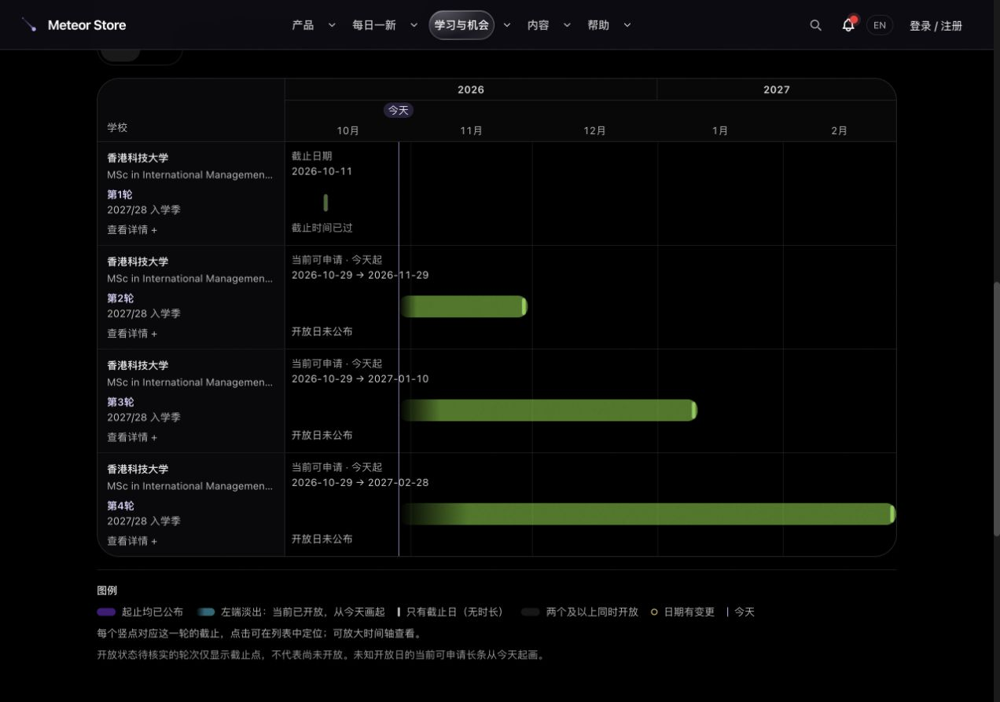

# 申请日历按批次展示与当前可申请区间

状态：已于2026-10-29北京时间17:22上线，运行提交 `cf6eaf517c707ad69a6334c00a5667d1a36a12ef`，部署后线上验收通过。

后续19:01已发布单页布局与侧边详情版 `bae94d9`，保留本文逐批次日期规则，交互改为日历在列表上方、点击打开侧栏；见[后续版本验收](2026-10-29-masters-single-page-release.md)。本文保留17:22版本证据。

用户于 2026-10-29 对已上线总览提出新的展示规则：已确认开放、开放日未知的申请从今天画到截止；同校不同批次分别换行。此规则替代上一版按项目合并和从首次核验日起画的约定。

## 行为

- 全年总览每个轮次一行，学校、项目、轮次与入学季明确显示，同校同色。
- 官方起止已公布：显示真实日期；尚未开放和已结束状态直接写明。
- 已确认当前开放但起点未知：显示北京时间今天至该轮截止，标明当前可申请和开放日未公布；今天不作为官方开放日，也不新增开放事件。
- 开放状态待核实：仅显示独立截止点，并明确这不代表尚未开放。已截止或关闭的轮次使用实际状态。
- 月历每轮独立色带，图例包含轮次和入学季；本月节点统计与北京时间规则保持不变。
- 精确截止时刻统一投影到北京时间日历日，原始时区在详情保留；跨日后仍有效的海外申请不会丢条。只有日期时不补时刻。
- 跨项目重叠按 `projectKey` 去重，同项目多个批次不虚增重叠项目数。
- 明确提前关闭的批次不计入未来重叠；截止点保持44×44px命中区；月历超过六条可见车道时提供其余申请期的展开入口。
- 首次开放证据字段、服务端保存和定时同步均保留；本轮只改变显示起点与分组，不删除证据，不更改申请者范围。

## 数据核查边界

本次核查没有把“有截止日”或“有申请按钮”当作已开放证明。

- [港大项目说明](https://master.cds.hku.hk/msccs/about/msc-in-computer-science-application-procedure-2027-28/)确认主轮、补录截止，未取得各轮当前开放的明确声明。
- [澳门城大招生处简章](https://ado.cityu.edu.mo/list-26/257)提供内地全日制硕/博第一轮报名区间，但现有项目条目面向一般申请者，不能无条件扩展到所有身份。
- [UQ 国际申请说明](https://study.uq.edu.au/admissions/postgraduate-coursework/submit-your-application)允许提前两年考虑申请；这是申请政策，尚未逐学季核验登录后的实际开放状态。

因此本次保持既有已核实状态，直接在行内展示未知状态；没有把范围不同或推断性质的证据改写为确定的开放状态。

## 验收目标

现有 10 轮公开记录应显示为 10 行：港科 4 轮独立，其中未截止的 3 轮从今天画起；NUS 保留官方起止长条。其余记录分别显示状态与截止。所有截止点仍准确定位到自身轮次，手机放大、横滚和详情可用。

本地全站 3563 项通过、43 项按原配置跳过，相关 ESLint 无错误或警告。已先复现新规则与时区/关闭边界的失败，再修复通过。源码冻结后以生产公开配置和只读数据库连接重新构建，并继续浏览器与上线验收。

## 发布与线上复验

- 干净提交副本使用生产公开配置与已确认只读的数据库连接构建，完整 TypeScript 与 415 页生成通过。实际待发布产物本地浏览器 18 项通过；没有部署隔离数据的预览构建。
- 正式包 SHA-256：`5fba8f9510d6f0dd3c748f036dedc2367bd362b27bfb7561884d58f2d637af0a`，上传后再核验。沿用双锁、产品空闲检查和既有激活流程，生产受管 PID `1672288` 直接持有 `127.0.0.1:3000`。
- 完整备份 `/var/backups/meteor-store-rounds-20261029-m8d4583k`，运行备份 `/var/backups/meteor-store-runtime-bsuTIKrq`。数据库备份含42表，已上传私有R2并回读校验。环境文件、Nginx/logrotate、cron均未变；无迁移、账号写入、人工回填或采集规则调整。
- 本次数据保存相关四文件未变，上一运行版本 `cb3f9fe` 已兼容首次证据字段。回滚包与匹配源码均保留，失败/信号由发布 wrapper 恢复；没有执行实际生产故障注入或回滚。当前版本如需回滚，可在核对备份后运行私有目录中的 `activate-rounds.sh rollback`，后续已另行部署时版本守卫会拒绝。
- 生产浏览器 20/20 通过：10轮独立行、4条有效长条、港科4批、逐个截止点定位、44px命中区、月历4条独立图例、11月2个截止、手机放大/横滚、键盘、单轮详情、中英文375/390px和学校筛选。同项目多批不会自行计为多项目重叠，无控制台error/warn。
- 8个页面、健康和硕士API均200；UQ两轮ICS输出2个事件；实际引用20个JS、3个CSS状态与MIME正常。服务器文件及公开特征chunk `3l8s3id6o_s3u.js` 均匹配 SHA-256 `2a4ab2b637ebba75faf89b993d428649c001dd75b9c5e5f09a48905a8436a36e`。
- 36次封面预热成功。GitHub/Gitee/GitLab已同步功能版本；验收附件作为后续文档提交，不改变运行版本。临时构建连接文件、只读隧道、本地预览及隔离数据库已清理或停止。

[发布摘要](masters-calendar-rounds-20261029/release.json) · [浏览器结果](masters-calendar-rounds-20261029/browser-online.json) · [HTTP结果](masters-calendar-rounds-20261029/http-online.json) · [哈希清单](masters-calendar-rounds-20261029/SHA256SUMS)

