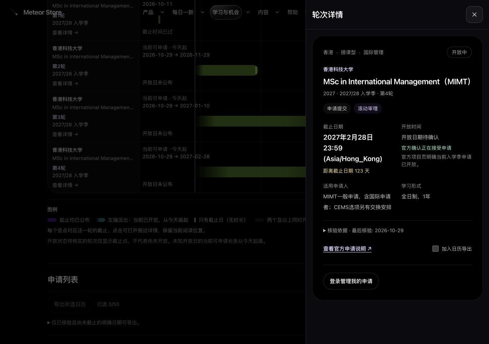

# 申请日历单页布局与侧边详情验收

状态：已于2026-10-29北京时间19:01上线，运行提交 `bae94d979288a7798ce686c15dd99d9b6af95933`，部署后线上验收通过。

2026-10-29，用户要求日历在列表上方，月历/全年日历两种显示方式可切换，点击长条打开侧边详情。本轮沿用此前提交、部署与线上复验授权。

## 实现

- 日历与申请列表同页显示、共用筛选；切换图表不卸载列表，不清理勾选或未保存进度。
- 全年日历学校、条形、截止点，月历色带、日期节点与轮次图例统一打开对应轮次侧栏，不滚动到列表。
- 桌面右侧480px，手机全宽，正文独立滚动；原生dialog支持Escape、关闭按钮、遮罩与焦点回环。关闭恢复真实触发按钮和背景滚动，搜索打开前同步释放模态，不抢焦点。
- 完整详情复用RoundCard，独立ID前缀隔离列表/侧栏；导出选择、进度草稿、busy/error由Hub共享。保存成功或取消关注才清该轮草稿，失败保留；换号/年份沿用组件隔离，筛选移除目标关闭详情。
- 保存中只禁用输入项，操作按钮通过aria-disabled与handler守卫保留焦点；关注成功时仅发起操作的卡片接住新进度控件焦点。每次打开详情回到内容顶部，背景页保持原位。
- 不修改日期投影、采集规则、申请者范围、数据库结构、服务端归属校验和提醒逻辑。

## 本地验证

- 全站3581项通过、43项按原配置跳过；TypeScript、相关ESLint、生产构建通过。
- 25项真实浏览器检查通过，使用隔离PostgreSQL及一次性测试账号。覆盖两个图表与常驻列表、10个截止点对应侧栏、原位关闭、月历键盘入口、遮罩、Tab/Shift+Tab、搜索交接、共享导出、共享未保存进度、真实本地保存及关注后的焦点、375/390px中英文。
- 原生保存实测发现fieldset整体disabled会使焦点落到BODY，已修复并重新验证；切换详情沿用内部旧scrollTop也已修复。
- 验收等待搜索既有180ms退场后再继续操作；不把中间态误点击计为有效验收。重复ID检查针对本轮卡片与表单，现有品牌SVG的bm-grad重复不归入本轮变更。
- 本地账号登录使用既有CSRF允许的localhost:3000；测试用户、关注和进度仅写入隔离数据库，没有对生产账号执行写入。

设计依据见[单页与侧栏方案](../superpowers/specs/2026-10-29-masters-single-page-design.md)。

## 正式发布

- 干净提交副本使用生产公开配置与已确认只读的数据库连接重新构建，完整类型检查通过；未部署隔离数据预览产物。正式包 SHA-256 为 `4ba451365ad55a4de626bfc244fb50c11f5f6b5a884dc72719c2c83f987e5f64`，包内排除cache/dev，上传后再次校验。
- 发布前完整备份 `/var/backups/meteor-store-single-page-20261029-ZpgUT8ZB`，数据库dump含42表，已上传私有R2并回读校验。运行备份 `/var/backups/meteor-store-runtime-NfmDqQRj`。
- 沿用双锁、产品空闲守卫和既有激活流程，受管Next PID `1679545` 自己持有 `127.0.0.1:3000`。应用/数据库/Redis健康；环境文件、Nginx/logrotate、cron不变，无迁移、手工回填或生产账号写入。
- 本轮服务与数据格式未变，上一运行版本 `cf6eaf5` 可兼容回滚。私有备份中的 `activate-single-page.sh rollback` 会核对准确运行版本与产物后恢复匹配源码和构建；已另行部署时会拒绝，不应绕过守卫。未进行生产故障注入或实际回滚。
- 功能提交已同步GitHub/Gitee/GitLab，验收附件随后以文档提交补交，不改变运行版本。36次产品封面预热全部成功。构建连接文件、只读隧道、本地服务及隔离测试账号已清理或停止。

## 线上复验

- 24项真实匿名浏览器检查通过：两个日历选项、图表在上/列表在下、十个截止点对应侧栏、月历图例/键盘色带/日期节点、侧栏原位关闭与焦点恢复、共享导出选择、Tab/Shift+Tab、搜索交接、遮罩、375/390px中英文、筛选同步、详情内部滚动复位，以及侧栏登录入口释放锁并到达页顶。
- 所检查页面无控制台error/warn。申请进度的真实写入只在隔离账号验证，未对生产账号做关注/保存测试。
- 8个页面与2个API全部200，生产仍为10条公开轮次；UQ两轮ICS含2个正确事件。实际引用20个JS、3个CSS的状态和MIME正常。
- 服务器与公开特征chunk `0v_bc0fu_9189.js` 均匹配 SHA-256 `1d8d3f75a6eabf3beff49f5b2cd7962fdb32a8ab33fb39ae02d1d9a4b0bab139`，未仅凭重复的BUILD_ID判断版本。

[发布摘要](masters-single-page-20261029/release.json) · [线上浏览器](masters-single-page-20261029/browser-online.json) · [HTTP检查](masters-single-page-20261029/http-online.json) · [本地浏览器](masters-single-page-20261029/local-browser.json) · [隔离账号保存结果](masters-single-page-20261029/local-auth-result.json) · [哈希清单](masters-single-page-20261029/SHA256SUMS)

